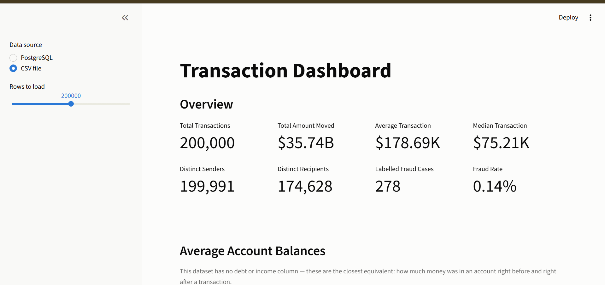

# Transaction Dashboard

A one-page Streamlit dashboard over the AML transaction data: totals, averages,
account balances, and a breakdown by transaction type. No model scores, no
fraud-detection jargon — just the basic numbers.

Built on `notebooks/data.csv` (or your live PostgreSQL `transactions` table,
if it's running) with ~5 million rows, but the page itself only shows plain
counts and dollar amounts.

---

## Screenshot

<!--
  Same file as the root README points at (dashboards/screenshots/dashboard.png)
  — save your screenshot once and it shows up in both places.
-->


*(Placeholder until you add one — see [the root README](../README.md#screenshot)
for exact steps on taking and saving it.)*

---

## What's on the page

| Section | What it shows |
|---|---|
| **Overview** | Total transactions, total amount moved, average transaction, median transaction |
| **Overview (row 2)** | Distinct senders, distinct recipients, labelled fraud cases, fraud rate |
| **Average Account Balances** | Average sender balance before/after a transaction, average recipient balance before/after |
| **By Transaction Type** | Two bar charts (transaction count, total amount) plus a table, broken out by `CASH_IN`, `CASH_OUT`, `DEBIT`, `PAYMENT`, `TRANSFER` |

A note on **"debt / income"**: the dataset doesn't have literal debt or
income columns. The closest real equivalent is **account balance before and
after a transaction** (`oldbalanceOrg` → `newbalanceOrig` for the sender,
`oldbalanceDest` → `newbalanceDest` for the recipient), so that's what the
"Average Account Balances" section shows. The page says this directly so
it's not a silent substitution.

---

## Running it

```powershell
cd C:\Users\USER\Downloads\Projects\AgenticAMLproject
.\venv\Scripts\Activate.ps1

pip install streamlit plotly      # one-time, if not already installed

streamlit run dashboards/simple_dashboard.py
```

This opens the dashboard at **http://localhost:8501**. Stop it with `Ctrl+C`
in the terminal.

### Data source

The sidebar has a toggle:

- **PostgreSQL** — reads live from your `transactions` table. Requires
  `DATABASE_URL` to be set correctly in `.env` and the database to be
  reachable.
- **CSV file** — reads directly from `notebooks/data.csv`. Use this if the
  database isn't running, or you just want to look at the raw data. A slider
  lets you pick how many rows to load (the full file is ~5 million rows, so
  a smaller sample keeps things fast).

If PostgreSQL fails to connect, the page shows a clear error and tells you
to try the CSV option instead — it won't crash silently.

---

## Where the code lives

```
dashboards/
  simple_dashboard.py   <- the page itself (start here)
  data_access.py         the only file that talks to the database / CSV
  README.md              this file
  screenshots/
    dashboard.png         <- your screenshot goes here
```

If you want to change what's on the page (add a metric, change a chart),
`simple_dashboard.py` is short and plain — every number on the page is one
line calling into `data_access.py`. You don't need to touch `data_access.py`
unless you want a number that isn't computed yet.

---

## Troubleshooting

| Problem | Fix |
|---|---|
| `streamlit: command not found` | Run `pip install streamlit plotly` inside the activated venv first. |
| Page says it can't connect to the database | Switch the sidebar to **CSV file** — it doesn't need the database at all. |
| Numbers look wrong / in the wrong currency | The data has no currency unit attached — the `$` on screen is cosmetic. Treat all amounts as the dataset's native units. |
| Port 8501 already in use | Another Streamlit app is probably still running — close that terminal, or run with `streamlit run dashboards/simple_dashboard.py --server.port 8502`. |

---

## Something more advanced?

There's also a deeper dashboard stack (fraud-model scores, SHAP explanations,
drift detection, precision/recall curves) plus a matching Power BI setup,
built on the same data. That's a lot more involved and not something most
people need — see [`ADVANCED.md`](ADVANCED.md) if you want it.

---

## A note on committing this file

This repo's `.gitignore` has a blanket rule that ignores all `*.md` files,
so `git add dashboards/README.md` won't do anything by default. If you want
this file (and your screenshot) tracked in git:

```powershell
git add -f dashboards/README.md dashboards/screenshots/dashboard.png
git commit -m "Add dashboard README and screenshot"
```
